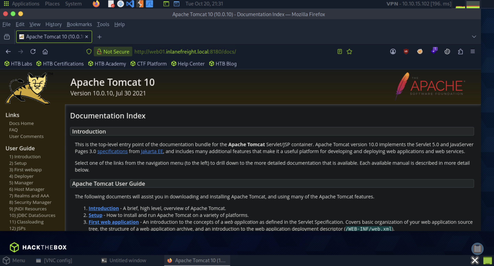

# Section 09: Tomcat - Discovery & Enumeration

Module: 24. Attacking Common Applications

---

## Questions & Answers

### 1. What version of Tomcat is running on the application located at http://web01.inlanefreight.local:8180?

Context:
- Visit `http://web01.inlanefreight.local:8180/docs` and easily saw the version:

**Answer:** `10.0.10`

---

### 2. What role does the admin user have in the configuration example?

Context:

**Answer:** `admin-gui`

---

[Back to Module Index](./README.md)
