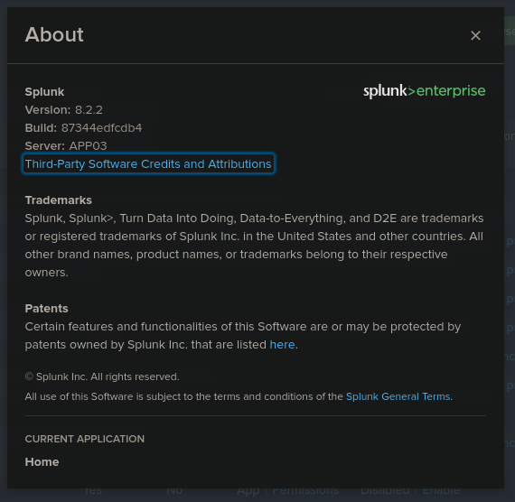

# Section 13: Splunk - Discovery & Emuneration

Module: 24. Attacking Common Applications

---

## Questions & Answers

### 1. Enumerate the Splunk instance as an unauthenticated user. Submit the version number to move on (format 1.2.3).

Context:
- Go to `https://10.129.201.50:8000` and click on `Help > About` to get the version:

**Answer:** `8.2.2`

---

[Back to Module Index](./README.md)
