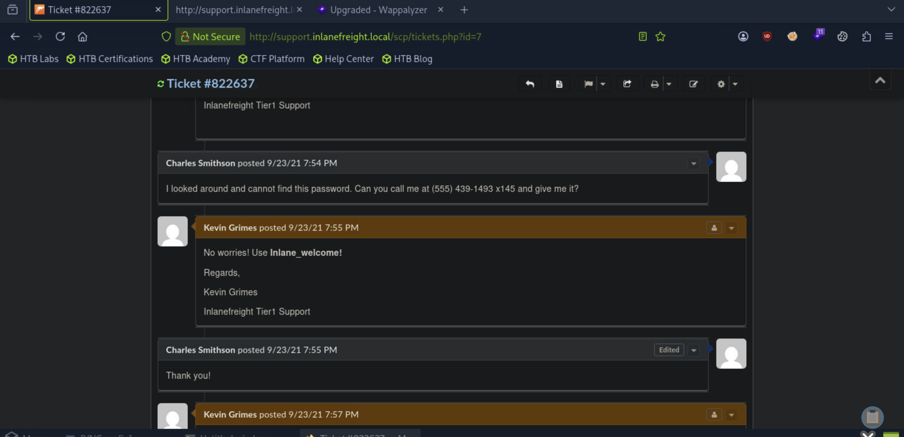

# Section 16: osTicket

Module: 24. Attacking Common Applications

---

## Questions & Answers

### 1. Find your way into the osTicket instance and submit the password sent from the Customer Support Agent to the customer Charles Smithson.

Context:
- Go to `/scp/login.php` and login with the credentials provided by the course `kevin@inlanefreight.local:Fish1ng_s3ason!`
- Go to `/scp/users.php` which is the tab **Users** click the user `Charles Smithson`, then we should see the ticket created by them, click on it to view the password:

**Answer:** `Inlane_welcome!`

---

[Back to Module Index](./README.md)