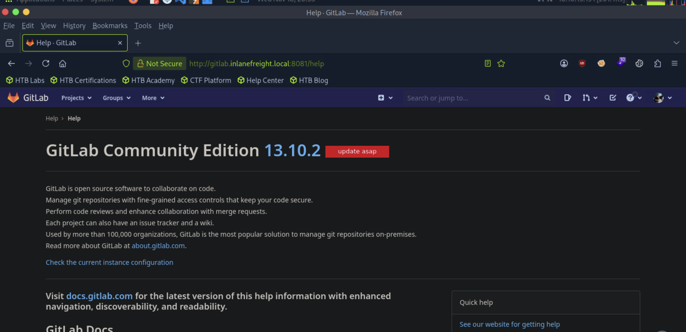
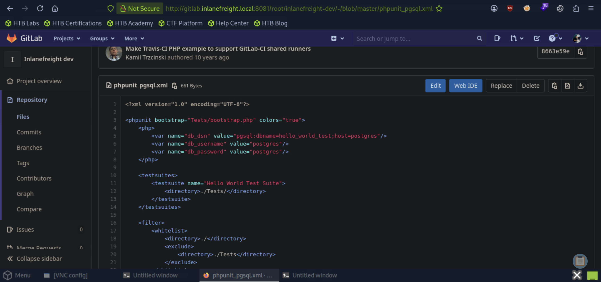

# Section 17: Gitlab - Discovery & Enumeration

Module: 24. Attacking Common Applications

---

## Questions & Answers

### 1. Enumerate the GitLab instance at http://gitlab.inlanefreight.local. What is the version number?

Context:
- Register an account then visit `/help` to view the Gitlab version

**Answer:** `13.10.2`

---

### 2. Find the PostgreSQL database password in the example project.

Context:
- Besides the `Inlanefreight website` listed in the course, there is another one: `Inlanefreight dev`, we can see the PosgreSQL credentials in the `phpunit_pgsql.xml`:

**Answer:** `postgres`

---

[Back to Module Index](./README.md)